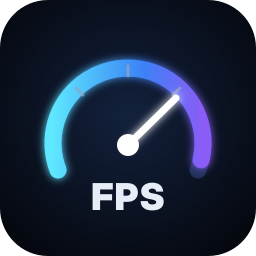
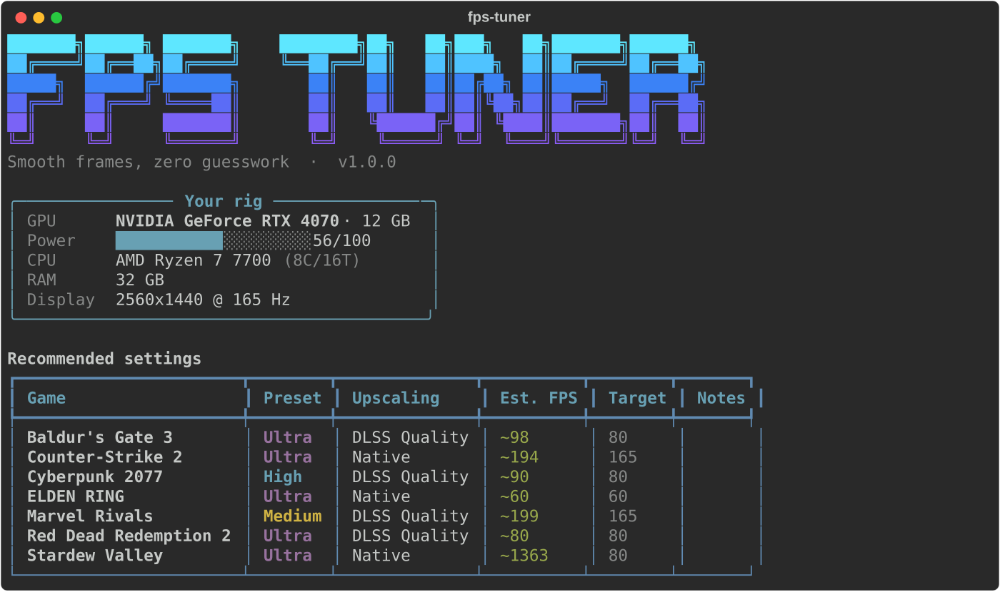
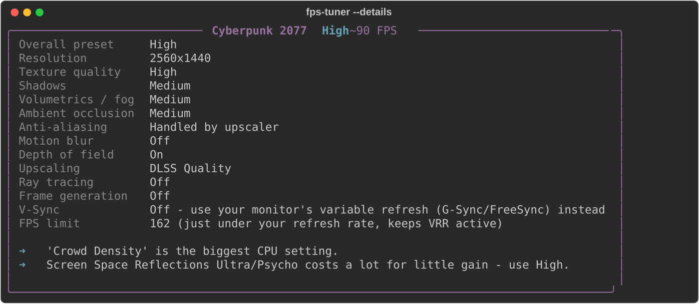

<p align="center">
  
</p>

<h1 align="center">FPS Tuner</h1>

<p align="center">
  <b>Smooth frames, zero guesswork.</b><br>
  Scans your PC and installed games, then tells you the best graphics settings for each one.
</p>

<p align="center">
  <a href="https://github.com/BullisticZA/fps-tuner/actions/workflows/ci.yml"></a>
  
  
  
</p>

<p align="center">
  
</p>

---

## ✨ What it does

1. **Scans your hardware:** GPU and real VRAM, CPU cores/threads, RAM, screen resolution and refresh rate.
2. **Finds your games:** reads your **Steam** (every library folder), **Epic** and **GOG** installs automatically.
3. **Recommends settings per game:** overall preset, textures, shadows, upscaling, ray tracing, frame generation, FPS cap and more, with an **estimated FPS** and game-specific tips.

It's smart about the details:
- 🎯 **Different goals for different games:** competitive shooters aim for your refresh rate (and at least 120 FPS for lower input lag); story games aim for a smooth 60–80 FPS with the best visuals.
- 🧠 **Picks the right upscaler:** DLSS on NVIDIA RTX, XeSS on Intel Arc, FSR everywhere else, and only if the game supports it.
- 🧱 **Textures follow VRAM, not GPU speed**, which avoids the stutter you get when textures overflow video memory.
- 🔍 **Spots bottlenecks:** warns when your CPU or RAM, not your GPU, is what's holding a game back.
- 🔒 **Read-only:** it never changes your games or system. It tells you what to set.

<p align="center">
  
</p>

## 🚀 Install

```bash
pip install git+https://github.com/BullisticZA/fps-tuner.git
```

Or from a clone:

```bash
git clone https://github.com/BullisticZA/fps-tuner.git
cd fps-tuner
pip install .
```

## 🎮 Usage

```bash
fps-tuner                                   # scan your PC and every installed game
fps-tuner --details                         # every setting for every game
fps-tuner --html report.html                # visual report you can open in a browser
fps-tuner -g "Cyberpunk 2077" -g "Valorant" # specific games, installed or not
fps-tuner --list-games                      # games with built-in profiles
```

Planning an upgrade? See what a different GPU or monitor would get you:

```bash
fps-tuner --gpu "RTX 5070" --vram 12 --resolution 2560x1440 --refresh 165
```

| Option | What it does |
|---|---|
| `-g, --game NAME` | Settings for specific games (repeatable), skips the library scan |
| `--resolution WxH` | Override the detected resolution, e.g. `2560x1440` |
| `--refresh HZ` | Override the detected refresh rate |
| `--gpu NAME`, `--vram GB` | Override the detected GPU, handy for "what if I upgrade?" |
| `--details` | Show every setting for every game |
| `--html PATH` | Save a visual HTML report |
| `--json` | Machine-readable output |
| `--no-anim` | Skip the animations |

## 🧮 How it works

Every GPU gets a **power rating** (RTX 4090 = 100) and every game a **demand rating**: the power needed for about 100 FPS on High at 1080p. FPS Tuner combines these with your resolution, refresh rate and CPU, then walks down a "quality ladder" (Ultra → High → High with upscaling → Medium …) and stops at the first step that reaches your target frame rate.

Over 40 popular games have hand-tuned profiles. Any other game gets a sensible generic profile, so it still gets recommendations.

> FPS figures are estimates to guide your settings, not benchmarks. Real results vary with drivers, game patches and the scene you're in.

## 🛠️ Development

```bash
pip install -e ".[dev]"
pytest          # 39 tests: scoring, recommendations, Steam/Epic scanning, CLI, HTML
ruff check .
```

Add or tune a game in [`fps_tuner/data/games.json`](fps_tuner/data/games.json). Pull requests with new game profiles are very welcome.

## 📜 License

[MIT](LICENSE) © 2026 Charl Britz. Game titles and GPU model names belong to their respective owners and are used only to identify them.
